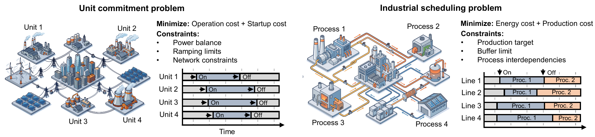
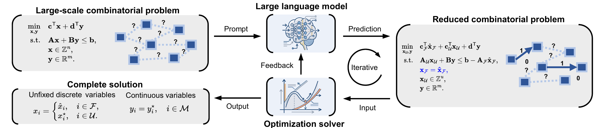
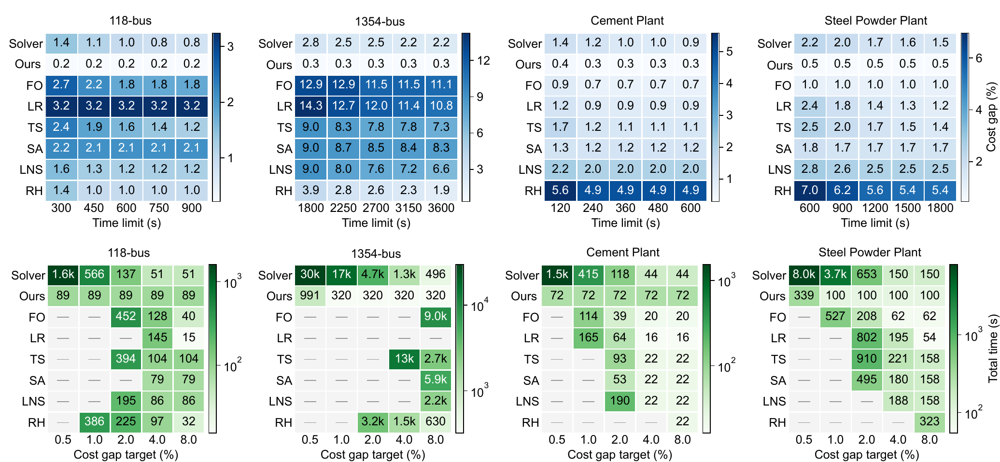

# Symbiotic LLM–Solver Optimization

Research code for paper **“Symbiotic LLM–solver optimization reduces energy system operating costs under operational deadlines”** by **Yehui Li, Yu Zuo, Ning Zhang, and Yi Wang**.

This repository provides the proposed method, mathematical models, benchmark inputs, and comparison methods for **unit commitment (UC)** and **industrial scheduling (IS)**.

[](figures/problem.pdf)

*The two application classes: unit commitment on the supply side and industrial scheduling on the demand side.*

## Overview

_The rapid transition to low-carbon energy systems demands increasingly frequent operational decisions, yet combinatorial intractability severely compromises the decision quality attainable within strict operational deadlines. This project develops a symbiotic large language model (LLM)–solver optimization framework that harmonizes generative contextual reasoning with rigorous mathematical programming to reduce operating costs by accelerating combinatorial optimization in energy systems._

In this symbiotic architecture, stochastic LLM predictions are screened through uncertainty-aware sampling into reliable discrete decision priors, reducing the combinatorial search space explored by the solver. In turn, concise solver diagnostics provide physical and economic feedback to drive targeted decision corrections, preventing generative hallucinations from compromising feasibility and solution quality.

The workflow has four steps:

1. **Generate candidate decisions.** Encode the instance, operating rules, and constraints in structured prompts and sample candidate discrete configurations.
2. **Select reliable assignments.** Use uncertainty estimates to fix selected discrete variables while leaving uncertain decisions available to the solver.
3. **Solve the reduced problem.** Optimize the remaining discrete variables and continuous decisions using the solver.
4. **Refine with solver feedback.** Use feasibility and cost-related diagnostics to revise or release fixed assignments and improve the solution.

[](figures/framework.pdf)

*The symbiotic optimization framework. Generative decision priors and mathematical solver feedback make search-space reduction selective and revisable.*

## Requirements

- **Python 3.10 or later**; development checks used Python 3.12.
- **Gurobi** with a license supporting the benchmark model sizes.
- Python dependencies: `numpy`, `pandas`, `pyomo`, `gurobipy`, `openai`, and `nest-asyncio`.
- An **OpenAI-compatible Chat Completions endpoint** for LLM-based methods.

From the repository root, install the dependencies:

```bash
python -m pip install -r requirements.txt
```

## Data

The repository contains four benchmark configurations spanning energy supply and industrial demand:

| Problem | Benchmark | CLI identifier | Python parameter |
|---|---|---|---|
| UC | 118-bus | `118-bus` | `params.uc.params_uc.bus118` |
| UC | 1354-bus | `1354-bus` | `params.uc.params_uc.bus1354` |
| IS | cement plant | `cement-plant` | `params.is.params_is.cement_plant` |
| IS | steel powder plant | `steel-powder-plant` | `params.is.params_is.steel_powder_plant` |

Each operational day contains **96 time steps of 15 minutes**. This project evaluates the benchmarks across **30 operational days**. `--days 0` selects the 1 day, and `--days 0:30` selects the 30 days.

```text
dataset/
├── uc/
│   ├── 118-bus/
│   │   ├── network_uc.json
│   │   ├── bus_load_uc.csv
│   │   ├── wind_uc.csv
│   │   ├── solar_uc.csv
│   │   └── reserve_uc.csv
│   └── 1354-bus/
└── is/
    ├── lmp_price_is.csv
    ├── pv_generation_is.csv
    └── production_order_is.csv
```

## Codes

Problem-specific implementations are separated into `uc/` and `is/` directories, with corresponding filename suffixes.

```text
.
├── ours/
│   ├── uc/                    # ours_uc.py, uncertainty_uc.py
│   └── is/                    # ours_is.py, uncertainty_is.py
├── baselines/
│   ├── uc/                    # fno_uc.py, sa_uc.py, lns_uc.py, ...
│   └── is/                    # fno_is.py, sa_is.py, lns_is.py, ...
├── solver/
│   ├── uc/solver_uc.py
│   └── is/solver_is.py
├── models/
│   ├── uc/model_uc.py
│   └── is/model_is.py
├── params/
│   ├── uc/params_uc.py
│   └── is/params_is.py
├── runners/
│   ├── run_uc.py
│   ├── run_is.py
│   └── cli.py
├── common/                    # Solver, API, path, and CSV utilities
├── dataset/                   # Benchmark input files
├── figures/                   # Figures files
├── record/                    # Solution record output CSV files
├── results/                   # Operating result output CSV files
├── requirements.txt
├── license
└── readme.md
```

### Methods

| CLI method | Description | Figure label |
|---|---|---|
| `solver` | Standalone Gurobi optimization | Solver |
| `ours` | Uncertainty-aware fixing and solver-guided refinement | Ours |
| `fno` | Fix-and-optimize | FO |
| `lr` | Lagrangian relaxation | LR |
| `tabu` | Tabu search | TS |
| `sa` | Simulated annealing | SA |
| `lns` | Large neighborhood search | LNS |
| `rh` | Rolling horizon | RH |
| `llm` | Direct LLM assignment baseline | Complete |
| `llm-confidence` | Confidence-based LLM assignment baseline | Confidence |

`ours/` contains the proposed method, `baselines/` contains the comparison methods, and `solver/` contains the standalone solver wrappers. The mathematical formulations are in `models/`, and benchmark parameters are in `params/`.

## Path configuration

Bundled paths are resolved in `common/paths.py`:

```python
PROJECT_ROOT = Path(__file__).resolve().parents[1]
DATA_ROOT = PROJECT_ROOT / "dataset"
```

`PROJECT_ROOT` is the directory containing `common/`, `runners/`, and `dataset/`. Inputs are read from `dataset/`, and generated files are written under the project root:

```text
record/uc/118-bus/solver.csv
results/uc/118-bus/solver.csv
```

`record/` contains daily status, objective values, timings, solver settings, and method diagnostics. `results/` contains time-step schedules for days with returned solutions. CLI runs also include method configuration and dependency versions in the daily record.

### Solver settings

`common/solver_config.py` manages the settings used by all methods:

```python
DEFAULT_TIME_LIMIT = 1e9
MIP_GAP = 1e-3
```

The default time limit **1e9** is a large finite value for runs without a practical time cutoff. The default solution gap is **0.1%**.

### LLM settings

Set credentials in the environment before running `ours`:

```bash
export OPENAI_API_KEY="your-key"
export LLM_MODEL="your-model-id"
```

For PowerShell, use `$env:OPENAI_API_KEY = "your-key"` and the same syntax for the other variables. `.env.example` lists the supported variables. `--llm-model` overrides the CLI model. Claude, Gemini, GPT, and DeepSeek models can be used through compatible endpoints.

## Key results

This project evaluates the symbiotic framework against the standalone solver and six acceleration baselines across the four benchmarks.

- **94.42–97.26% shorter solution times**, with cost gaps within **0.46%** of the reference optimum.
- **2.45% lower operating cost** than the standalone solver for the **1354-bus** case under a **30-minute** operational deadline.
- **1.76% lower operating cost** than the standalone solver for the **steel powder plant** under a **10-minute** operational deadline.

[](figures/result.pdf)

*Computational performance and economic savings reported in the paper. Top: cost gaps attained under different computational time limits. Bottom: total time needed to reach specified cost gap targets.*

## Quick start

Run the following commands from the repository root.

### 1. Check the inputs

Validate the 118-bus case as:

```bash
python -m runners.run_uc --case 118-bus --days 0:30 --dry-run
```

### 2. Run the standalone solver

Solve the 118-bus case with the default settings:

```bash
python -m runners.run_uc --case 118-bus --method solver --days 0
```

To set a 600-second solver limit:

```bash
python -m runners.run_uc --case 118-bus --method solver --days 0 --time-limit 600
```

### 3. Run the proposed method

Solve the 118-bus case after setting the LLM environment variables:

```bash
python -m runners.run_uc --case 118-bus --method ours --days 0 --n-samples 15 --max-refine-iter 5
```

Ours supports three variable selection strategies:

| Strategy | Parameter | Selection rule |
|---|---|---|
| `epistemic_threshold` | `tau_I`, default `0.1` | Fix variables with uncertainty strictly below the threshold |
| `epistemic_percentile` | `alpha`, default `0.5` | Fix variables at or below the selected uncertainty percentile, including ties |
| `epistemic_budget` | `beta`, default `0.3` | Fix variables in increasing uncertainty order within a cumulative budget |

For example:

```bash
python -m runners.run_uc --case 118-bus --method ours --days 0 --strategy epistemic_percentile --strategy-params '{"alpha": 0.3}'
```

Other method arguments can be supplied through `--method-options`:

```bash
python -m runners.run_uc --case 118-bus --method lns --days 0 --method-options '{"max_iter": 30, "destroy_ratio": 0.05, "lr_warmup_iters": 20}'
```

Use `python -m runners.run_uc --help` or `python -m runners.run_is --help` for the available CLI options.

### 4. Run from Python or a Notebook

With the project root as the current working directory, the following code runs only the 118-bus standalone solver and saves results to the default folders:

```python
from params.uc.params_uc import bus118
from runners.run_uc import UnitCommitmentRunner

runner = UnitCommitmentRunner(
    days=list(range(30)),
    params=bus118,
    time_limit=1e9,
)
runner.run_solver()
```

For Ours, call `runner.run_ours(llm_model="your-model-id", n_samples=5, max_refine_iter=5)` after setting credentials.

## Citation

Please cite the associated manuscript and this repository when using the code or processed data. Full bibliographic information will be added here after publication.

## License

The code is released under the [MIT License](license). Benchmark metadata and attribution are retained in the network data. External solvers, APIs, and third-party data retain their respective terms.
